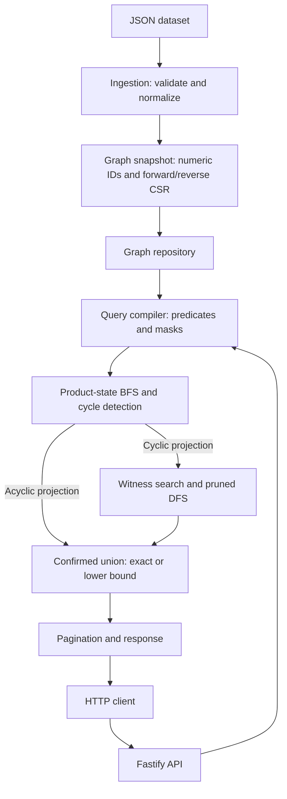

# Backslash Graph Query Engine

A TypeScript REST backend for filtering directed property graphs by matching simple paths. It returns a compact graph for visualization and can also enumerate a bounded list of actual matching paths. The supplied Train Ticket dataset is included.

## Quick start

Requires Node.js 22+.

```sh
npm ci
npm run build
npm start
```

Open [Swagger UI](http://localhost:3000/docs). The default bind address is `127.0.0.1:3000`. Configure `HOST`, `PORT`, `GRAPH_FILE` or `MISSING_NODE_POLICY` through environment variables.

```sh
curl -X POST http://localhost:3000/api/v1/routes/query \
  -H 'Content-Type: application/json' \
  -d '{"query":{"operator":"AND","filters":[{"type":"public"},{"type":"sink"},{"type":"vulnerability"}]}}'
```

For this dataset all three filters together have no matching path. The response (only `graphVersion` shortened):

```json
{
  "nodes": [],
  "edges": [],
  "meta": {
    "graphVersion": "<snapshot version>",
    "nodeCount": 0,
    "edgeCount": 0,
    "completeness": "exact",
    "pageSize": 500,
    "hasMorePages": false,
    "nextCursor": null,
    "algorithm": "product-bfs",
    "stage": "complete",
    "operations": 771,
    "unverifiedNodes": 0,
    "unverifiedEdges": 0
  }
}
```

Try the `public` filter alone to see the reachable frontend region and isolated public gateway. On the supplied data: `public` 8 nodes / 6 edges, `sink` 21 / 40, `vulnerability` 23 / 42, `sink` + `vulnerability` 21 / 40, and any combination of `public` with `sink` is empty.

## API

| Method | Path | Purpose |
|---|---|---|
| GET | `/health` | Health check |
| GET | `/api/v1/graph` | Original graph, paginated |
| GET | `/api/v1/graph/meta` | Snapshot counts and ingestion diagnostics |
| GET | `/api/v1/graph/nodes/:id` | Full node properties |
| GET | `/api/v1/filters` | Registered filters |
| POST | `/api/v1/routes/query` | Union of matching nodes and edges |
| POST | `/api/v1/routes/paths` | Bounded explicit matching paths |
| GET | `/api/v1/results/:cursor` | Next page of a stored graph result |
| GET | `/docs` | Interactive OpenAPI documentation |

The graph endpoint returns node summaries and canonical edge IDs with source and target IDs. Each page includes its edge endpoints. Merge pages by IDs within the same graph version; repeated endpoints are expected. `pageSize` defaults to 500, maximum 2000 primary entries. Follow `meta.nextCursor` until null. Gzip is negotiated through `Accept-Encoding`.

**The union is not a list of matching paths.** Edges from different valid paths may combine into a route that fails a filter. To identify valid individual routes, use the explicit paths endpoint:

```sh
curl -X POST http://localhost:3000/api/v1/routes/paths \
  -H 'Content-Type: application/json' \
  -d '{"query":{"operator":"AND","filters":[{"type":"public"}]},"limit":20}'
```

Each path has ordered `nodes` (external IDs) and `edges` (canonical IDs). Zero-edge paths have one node and no edges. `limit` defaults to 20, maximum 100; total output is capped at 100,000 node/edge ID entries. This endpoint does not page or resume enumeration. `exact` means enumeration exhausted; `lowerBound` means the returned paths are valid but more may exist. `PATH_LIMIT`, `OUTPUT_LIMIT` or an execution stop reason identifies truncation.

For graph queries, `exact` means the complete union is available across pages; `lowerBound` includes only confirmed items. Missing items in a lower bound cannot be considered nonmatching. Pagination is independent of computation completeness; it does not resume interrupted computation. Unverified candidate counts may be null if preprocessing did not complete.

## Filters and extensibility

The built-in filters select paths that start at `publicExposed: true`, end at `rds` or `sql`, or contain a nonempty vulnerabilities array. They can be combined with AND. Generic predicates support `START`, `END`, `ANY_NODE`, `ALL_NODES`, `ALL_EDGES` and operators `eq`, `in`, `exists`, `notEmpty`, `gt`, `lt`. Up to 32 filters, including at most five ANY filters. `maxDepth` optionally limits edges; no implicit depth cutoff.

For example, send this request body to select paths containing a high-severity vulnerability:

```json
{
  "query": {
    "operator": "AND",
    "filters": [{
      "scope": "ANY_NODE",
      "predicate": {"field": "vulnerabilities.severity", "op": "eq", "value": "high"}
    }]
  }
}
```

Dotted paths traverse intermediate arrays existentially; terminal arrays remain intact. Only own properties are read. A literal property matching the complete field name takes precedence. To require multiple conditions on the same array element, use a trusted server-side custom predicate:

```typescript
const registry = createDefaultRegistry().registerCustom({
  id: 'high-public',
  description: 'Contains a public node with a high-severity vulnerability',
  scope: 'ANY_NODE',
  match: (entity) => entity.properties.publicExposed === true &&
    Array.isArray(entity.properties.vulnerabilities) &&
    entity.properties.vulnerabilities.some((item) =>
      item !== null && typeof item === 'object' &&
      'severity' in item && item.severity === 'high'),
});
// Supply registry through buildApp(repository, { service: { registry } }).
```

Clients refer to the registered filter by `{ "type": "high-public" }`. Functions are never accepted from request JSON. Custom callbacks are trusted, synchronous and should be pure and bounded. Named declarative filters can also be added with `registry.register`.

## Input assumptions

- Normalize string and array edge targets. Reject malformed structure and duplicate node identities. Preserve unknown properties, distinct parallel edges, and stored self-loops; deduplicate identical edges.
- The undeclared `assurance-service` becomes an unresolved placeholder by default; alternatively drop affected edges or reject the input. Default normalization: 47 nodes, 98 edges (46 declared nodes).
- Missing vulnerabilities mean none. Missing public exposure does not satisfy the public filter and remains unknown in the node summary.
- Paths are directed and simple (no repeated vertex); include valid subpaths, endpoints in ANY predicates, and zero-edge paths including isolated nodes. Self-loops are not traversed.

## Design and complexity

`src/ingestion` validates and normalizes; `src/graph` stores an immutable snapshot with numeric IDs and forward/reverse CSR adjacency; `src/query` compiles and executes filters independently of HTTP; `src/api` exposes the service and paginated responses. The query engine captures one snapshot from the repository per query. A future dynamic graph can publish new snapshots without changing traversal.



Compilation creates start/end sets, allowed node/edge masks and one bit per ANY predicate. Forward and reverse BFS on implicit `(node, mask)` states find accepting walks, with distances supporting `maxDepth`. A transition ORs in the destination's bits; reverse traversal uses inverse OR mappings. Project only compatible reachable states and transitions onto the original graph. Kahn's cycle check on this projection proves exactness when acyclic: any repeated vertex in an accepting walk would create a directed cycle.

Two steps reduce work on cyclic candidates without changing the answer:

- **Boundary pruning** (before the BFS). A simple path never re-enters its first node or leaves its last node. If exactly one node can start a path, edges into it are on no matching path; if exactly one node can end a path, the same holds for edges out of it. These edges are removed before the BFS, which often makes the projection acyclic. With several starts or ends nothing is pruned.
- **Targeted witnesses** (`src/query/witness.ts`). For each unconfirmed candidate edge, build one candidate path: walk back from the edge source along decreasing forward distances and forward from its target along decreasing backward distances, skipping nodes already on the path. A separate checker verifies that the result is a matching simple path (distinct nodes, valid start and end, all ANY bits, `maxDepth`) before any item is marked. A failed attempt proves nothing. This pass may use at most half of the remaining operations.

Iterative DFS with path-local visits and backward-distance pruning then handles the remaining items. For remaining cyclic candidates, exhaustive DFS can prove that an unconfirmed item is on no matching path. It stops once every candidate is confirmed or the work budget is exhausted. Explicit enumeration uses the same compilation, pruning and backward distances but emits complete paths rather than union masks.

For V vertices, E edges and M = 2^k masks (k ANY predicates), product traversal and projection take O((V+E)M) time and O(VM+V+E) auxiliary space, plus O(M²) inverse tables. Compilation adds predicate evaluation costs; nested property traversal and custom predicates need not be constant time. Ingestion sorts identifiers and edges, then builds CSR in linear time (excluding property processing). A witness attempt costs O(L·d·M) for a path of length L and average degree d. DFS and explicit enumeration can take exponential or factorial time; explicit output also costs the total length of returned paths. No general latency or completeness guarantee is claimed for arbitrary cyclic graphs.

## Resource limits and trade-offs

Default operation budget: 25 million; cooperative deadline: five seconds. Compilation and traversal share these limits and yield to the event loop. Cancellation is wired to HTTP disconnect. The estimated typed-array allocation cap is 128 MiB, not a total-process memory limit. Request bodies are limited to 64 KiB and at most two queries are active. Graph cursors use a bounded single-process result store (16 entries, 32 MiB of ID arrays, two-minute TTL, FIFO eviction). Cursors are signed and expire on eviction, restart or snapshot replacement. Clients may evict each other's results; single-page results are not cached. Production authentication, network rate limiting and distributed storage are outside scope.

The union is kept as the default because enumerating all paths is unsuitable for large graphs.

### Limits of exact simple-path queries on cyclic graphs

Deciding whether a given edge lies on some simple path between two vertex sets is NP-hard on general directed graphs (it contains the two-disjoint-paths problem). No polynomial-time exact algorithm is known for every input; this engine instead bounds the work and labels the result.

- Witnesses confirm items quickly when short matching paths exist. The tested complete digraphs of 12, 30 and 200 nodes return exact results under the default budget.
- An item that remains in the walk-based upper bound but lies on no matching simple path may require exhaustive DFS to exclude it in this implementation. In a dense cyclic core this is exponential. `benchmark/stress.mjs` includes such a case (`dense-core-false-detour`): every real item is confirmed, the two walk-only edges stay unverified, and the result is `lowerBound`.
- The witness pass adds cost before the DFS when many attempts fail. On a 100,000-node chain with 1,000 long back edges, the query needs about 14M operations instead of 2.4M. The tested instance remains exact; reserving part of the operation budget for DFS limits witness overhead but does not guarantee exactness.

A `lowerBound` result never contains an item that is not on a matching path, but missing items are not proven nonmatching.

## Verification and benchmarks

```sh
npm run format:check
npm test                         # unit, contract and differential tests
npm run test:api                 # Fastify integration tests
npm audit
npm run bench                    # 100,000 nodes, extended budget (100M operations, 30 s)
npm run bench:defaults           # 100,000 nodes, production defaults (25M operations, 5 s)
npm run bench:stress             # dense and adversarial cyclic graphs, production defaults
node benchmark/differential.mjs  # 3,000 random graphs against brute force; non-zero exit on mismatch
node benchmark/http-smoke.mjs    # real socket: responsiveness, concurrency, abort, errors
```

The tests compare the engine with independent brute-force enumeration (random sparse and dense cyclic graphs, ANY masks, depth limits), cover every new pruning and witness rule, and sweep operation budgets to check that partial results stay sound. The union contract test shows that every returned item lies on a matching path, that union edges can combine into a nonmatching route, and that `/routes/paths` returns only actual matching paths.

### Measured results

Measured on an Apple M3 Max, macOS arm64, Node.js v24.18.0, `--expose-gc`, production defaults (`npm run bench:defaults`):

| Scenario | Nodes | Edges | Load ms | Query ms | Operations | Completeness | JSON MB | Gzip MB |
|---|---:|---:|---:|---:|---:|---|---:|---:|
| Chain | 100,000 | 99,999 | 190.54 | 115.34 | 1,949,991 | exact | 25.03 | 1.39 |
| Branching DAG | 100,000 | 199,997 | 233.08 | 179.03 | 2,949,967 | exact | 30.56 | 1.79 |
| Cyclic (boundary back edge) | 100,000 | 100,000 | 192.26 | 128.40 | 1,949,996 | exact | 25.03 | 1.39 |
| Interior cycle | 100,000 | 100,000 | 203.85 | 197.04 | 2,450,007 | exact | 25.03 | 1.39 |
| Dense DAG | 100,000 | 999,945 | 813.50 | 501.33 | 10,149,439 | exact | 75.17 | 5.98 |

The boundary back edge is removed before BFS; the interior cycle exercises the DFS fallback. A deliberately restricted cyclic-budget run returns a labeled lower bound.

Dense cyclic stress tests, on the same machine with production defaults (`npm run bench:stress`):

| Complete digraph | Before optimization | Final operations | Final query ms | Final completeness |
|---|---|---:|---:|---|
| 12 nodes | 25M operations, lowerBound | 3,173 | 3 | exact |
| 30 nodes | 25M operations, lowerBound | 44,474 | 11 | exact |
| 200 nodes | 25M operations, lowerBound | 12,187,829 | 1,297 | exact |

The adversarial dense-core-false-detour scenarios still return sound lower bounds under the 25M-operation budget, leaving one node and two edges unverified in each tested case.

Final verification: 73 unit and regression tests plus 2 HTTP integration tests passed, with no failures or TODOs. The independent differential benchmark checked 3,000 random graphs (642 cyclic), with zero mismatches and zero non-exact results. The HTTP smoke benchmark exercised responsiveness, concurrency limits, cancellation and error responses.

The benchmark also reports retained heap, first-page latency and page counts. JSON and gzip sizes are sums of serialized result pages (page size 2,000), not measured network transfer or browser rendering. Retained heap is not peak process memory. These measurements describe the tested workloads, not a general latency guarantee.

## Docker and CI

```sh
docker build -t backslash-engine .
docker run --rm -p 127.0.0.1:3000:3000 backslash-engine
```

The multi-stage image runs as the non-root `node` user. GitHub Actions runs format check, build, unit and integration tests and `npm audit` on Node.js 22 and 24, then builds the image, starts a container and polls `/health`. Both CI jobs, the Docker build and runtime, and manual API calls against the container have been verified.

## Future work (not implemented)

- **OR.** Path-level semantics means each path must satisfy the expression; unioning results is valid for OR over complete AND clauses, not for independently evaluating individual AND predicates. One way to do this is to rewrite the expression into a disjunction of AND clauses, run each clause on the same snapshot with a shared budget, and union the confirmed items. The rewrite can grow exponentially, so it must be bounded. Boundary pruning must be justified for each clause; pruning based on a unique start or end in only one clause is not safe globally. The result is `exact` only if every clause is exact.
- **Progressive visualization.** Send counts first (per node kind or per strongly connected component), then the matching region page by page, edges with their endpoints. Fetch node details on demand and use `/routes/paths` for drill-down. Large results can be streamed instead of paged. A client merges pages by ID, so stable IDs are required.
- **Dynamic graphs.** Queries capture one immutable snapshot, and cursors are tied to it. A writer can build and validate a new snapshot and publish it atomically through the repository, without changing traversal code. Edge IDs are currently positional (`e<n>`) and change between snapshots; content-based edge IDs, an update endpoint and incremental indexes would be needed for clients to apply differences.
